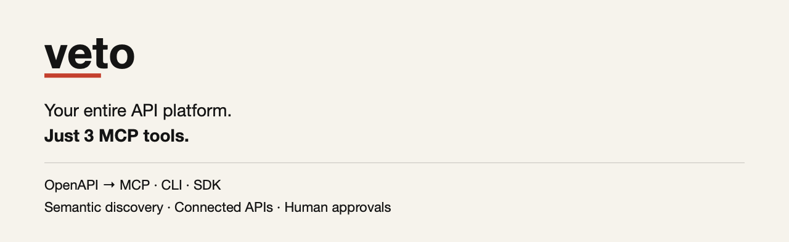

# Harbor. See veto in action.

**25 operations. 3 MCP tools.**

Harbor sells home goods. Orders, customers, and billing are three OpenAPI services. An agent does not get a tool for each operation. It gets search, describe, and invoke.

```text
capabilities_search, capabilities_describe, capabilities_invoke
Harbor publishes more than twenty operations. The agent sees these three.
orders.get  →  customers.get   by Order.customerId
orders.get  →  invoices.get    by Order.invoiceId
Mara's order was read, then her customer, then her invoice.
Cancel reached the desk. Delete did not, until a person approved it.
The approved id ran once.
```

That is what the automated walk prints. No paid service. No model API key.

## Try it

```bash
git clone -b demo-three-tools https://github.com/aiveto/veto-demo.git
cd veto-demo
make demo
```

Requires Go 1.27.1.

`make demo` is a script. It starts Harbor, plays the story through the CLI, then plays the same story through a scripted MCP client. It does not open Claude, Cursor, or ChatGPT.

1. Run `make demo`.
2. Watch the three tools, then the links from order 10482 to the customer and the invoice.
3. Watch the delete wait until a person approves it.

## What you see

Harbor has 25 operations. The scripted MCP client is offered three tools. Search finds the call. The raw specs stay out of that list.

Order 10482 is Mara Ellison's wool coat and two cedar trays, $556. The links are written in `app/relations.yaml`:

`orders.get` → `customers.get` and `invoices.get`

The invoice is paid. The warehouse id on the order is not a relation, so nothing calls it. No guessed endpoint.

Retire order 10482. Veto holds `orders.delete`. The pending id is not permission. Sending it back is `pending_approval` and does not call Harbor. `veto approve --config app/veto.yaml` prints a second id. That id runs the delete once, and then the order is gone.

Cancel is a different call. Order 10490, Jonas Adler's linen throw, reaches Harbor without that wait.

## Your own agent

`make mcp` is the other experience. It leaves Harbor listening and prints the config for a client. It does not play the story for you.

```bash
make mcp
```

1. Paste that config into Claude, Cursor, or ChatGPT.
2. Paste `app/prompts/claude.md` as the instruction.
3. Ask it to read Mara's order and follow the customer and the invoice.
4. Ask it to retire the order. The pending id is only a request. Approve it, hand the agent the second id, and the delete runs once.

`make cli` plays the same story through `veto search`, `veto describe`, and `veto invoke`. A skill follows `app/prompts/skill.md`.

Harbor listens on `127.0.0.1:18410` (orders), `:18411` (customers), and `:18412` (billing). Calls want `Authorization: Bearer demo-token`.

## The files

| | |
| --- | --- |
| Three OpenAPI services | `app/contracts/` |
| The catalog | `app/veto.yaml` |
| An extra word, such as scrap for delete | `app/semantics.yaml` |
| The links between services | `app/relations.yaml` |
| The agent instruction | `app/prompts/claude.md` |

Change a word. Add a relation. Harbor stays local. On your own APIs, veto points at the services where they already run.

[Explore veto](https://github.com/aiveto/veto/blob/readme-three-tools/README.md) · [Setup guide](https://github.com/aiveto/veto/blob/readme-three-tools/docs/guide.md)
